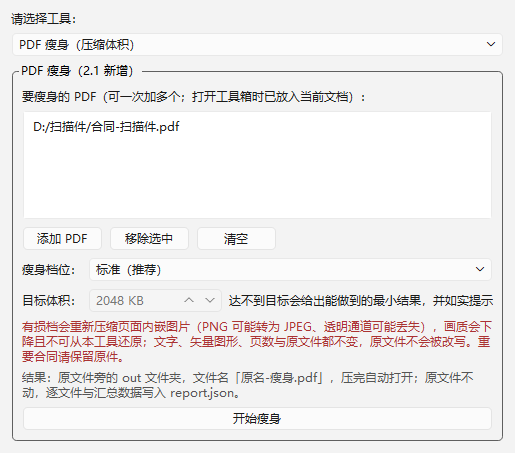

# PDF 瘦身使用说明（PDF 阅读器 2.1）

> 一句话：把扫描件 PDF 里的图片重新压一遍，**文字还能搜、页数不变、原文件不动**，结果放在原文件旁的 `out` 文件夹。



## 三步上手

1. 打开 PDF 阅读器，点菜单「工具 → PDF 工具箱」（或工具栏「PDF 工具箱」按钮）。
2. 在下拉框里选最后一项 **「PDF 瘦身（压缩体积）」**。打开工具箱时，当前正在看的 PDF 已经自动放进文件列表；要点「添加 PDF」可以一次选多个，也可以清空后重选。
3. 选档位（默认「标准（推荐）」），或选「自动（按目标体积挑档）」并填一个 KB 数，点 **「开始瘦身」**。进度走完会弹出「原 X → 现 Y，省了 Z」，并自动打开输出文件夹。

## 四档怎么选

下表是本机实测（2026-11-12，PyMuPDF 1.28.2，3 页 A4、每页一张 900×1200 噪声图；噪声图属于最难压的样张）：

| 样本 | 原文件 | 无损整理 | 轻度 | 标准（推荐） | 强力 |
|---|---|---|---|---|---|
| PNG 扫描件 | 3.09 MB | 3.09 MB（100%） | 1.36 MB（44%） | 1.06 MB（34%） | 808.8 KB（26%） |
| 已 JPEG 压缩的扫描件 | 1.01 MB | 1.01 MB（100%） | 915.3 KB（88%） | 725.7 KB（70%） | 556.5 KB（54%） |
| 纯文字 PDF | 1.4 KB | 1.4 KB（95%） | 1.4 KB（96%） | 1.4 KB（96%） | 1.4 KB（96%） |

| 档位 | 画质 | 什么时候用 |
|---|---|---|
| 无损整理 | 100% 不变，不重新编码图片 | 只想清理 Word / 网页另存带来的冗余对象；已压缩过的扫描件通常没有收益 |
| 轻度 | 肉眼几乎无差 | 还要放大看细节的图纸、照片 |
| 标准（推荐） | 文字清晰，图片细节略降 | 邮件附件、微信发送、归档，最常用 |
| 强力 | 细节明显下降 | 只要能看清大概的存档件、备份件 |

**纯文字 PDF 基本压不动**——本来就没有图片可压。工具不会为了凑数字把文件弄大：任何档位压完没变小，就原样输出一份，并在结果里注明。

## 按目标体积自动挑档

档位选「自动（按目标体积挑档）」，填目标体积（单位 KB，1 MB = 1024 KB）。

程序按 **无损整理 → 轻度 → 标准 → 强力** 的顺序试，第一个达到目标的结果就用它，所以总是「够用就好、画质尽量高」。例如填 `2048`，如果标准档已经压到 1.8MB，就不会再动用强力档。

四档都达不到目标时，会输出能做到的最小结果，并在弹窗和 `report.json` 里如实写 `target_reached: false`，不会假装达标。

## 有损披露（用之前请看完）

- 除「无损整理」外，都会**重新编码页面内嵌图片**：PNG 可能转成 JPEG、透明通道可能丢失，画质下降且**不能由本工具还原**。
- **文字层、矢量图形、页数、书签/大纲不变**：文字仍然可以选中、复制、搜索。引擎每次都会比对逐页文字层指纹和页数，一旦发现变化就回退成原样输出。
- **原文件绝不改写**。结果另存为 `out\原名-瘦身.pdf`，同名已存在时自动加 `-2`、`-3`。
- **全程 0 联网**：不上传、不登录、不云同步，`report.json` 里 `network_attempts` 恒为 0。
- 重要合同、证件、发票请保留原件，瘦身结果只作为发送 / 归档副本。

## 输出与报告

处理完成后，在原文件所在目录生成：

```
原目录\
  合同.pdf                      ← 原文件，一字未动
  out\
    合同-瘦身.pdf                ← 结果
    合同-瘦身.report.json        ← 这一个文件的明细
    report.json                  ← 本批次汇总
```

`report.json` 主要字段：

| 字段 | 含义 |
|---|---|
| `version` | 2.1 |
| `level` / `requested_level` | 实际模式（`auto` 表示按目标体积挑档）/ 原本选的档 |
| `network_attempts` | 联网次数，恒 0 |
| `items[].before_bytes` / `after_bytes` | 真实前后体积 |
| `items[].ratio` / `saved_bytes` | 压缩率与省下的字节 |
| `items[].level_used` | 这个文件最后实际用的档（可能是「原样输出」） |
| `items[].pages` / `text_layer_same` | 页数与文字层校验结果 |
| `items[].target_reached` | 自动模式下是否达到目标体积 |
| `items[].status` | `ok` / `ok-no-gain`（没变小，原样输出）/ `skipped` / `failed` / `cancelled` |
| `skipped` | 收集阶段跳过的路径与原因 |
| `summary` | 输入数、成功数、跳过数、失败数、总前后体积、总压缩率 |

点「取消」时，本轮已经写出的文件会全部回滚，不会留下半截结果。

## 常见问题

**Q：压完怎么没变小？**
A：文件本来就是高压缩的 JPEG 扫描件，或者根本没有图片（纯文字 / 纯矢量）。此时结果会原样输出，弹窗里也会写「压完没变小，已原样输出」。

**Q：文字还能搜索、复制吗？**
A：能。瘦身只替换图片数据流，文字层不动；引擎还会逐页校验文字指纹，不一致就回退。

**Q：加密 / 带密码的 PDF 能压吗？**
A：不能，会跳过并在报告里写明原因。请先用工具箱的「加密 PDF」相关流程处理好，或先用阅读器打开确认能读。

**Q：能撤回吗？**
A：能。删掉 `out` 里的结果即可，原文件从来没被改过。

**Q：会上传我的文件吗？**
A：不会。瘦身引擎不导入任何网络库，自检里还会掐断 socket 跑一遍证明不联网。

**Q：一次能压多少？**
A：文件列表里加多少就压多少，逐个处理并写进度；目录方式的命令行入口会自动跳过 `out` 产物目录，避免把压过的再压一遍。

## 命令行（可选）

```bat
venv\Scripts\python.exe cli_slim.py "D:\扫描件\合同.pdf" --level standard
venv\Scripts\python.exe cli_slim.py "D:\扫描件" --target-kb 2048
venv\Scripts\python.exe cli_slim.py "D:\扫描件" --level lossless --json
```

| 参数 | 说明 |
|---|---|
| `--level` | `lossless` / `light` / `standard` / `strong`，默认 `standard` |
| `--target-kb` | 目标体积（KB），>0 时自动阶梯挑档 |
| `--out` | 统一输出目录；不填则各自落在原文件旁 `out` |
| `--json` | 只打印 report.json 内容，便于脚本解析 |
| `--selftest` | 构造真实 PDF 跑一次自检 |

命令行与界面用的是同一个 `pdf_slim.py` 引擎，结果口径完全一致。
